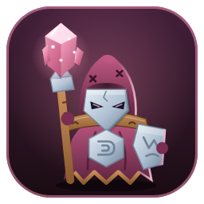
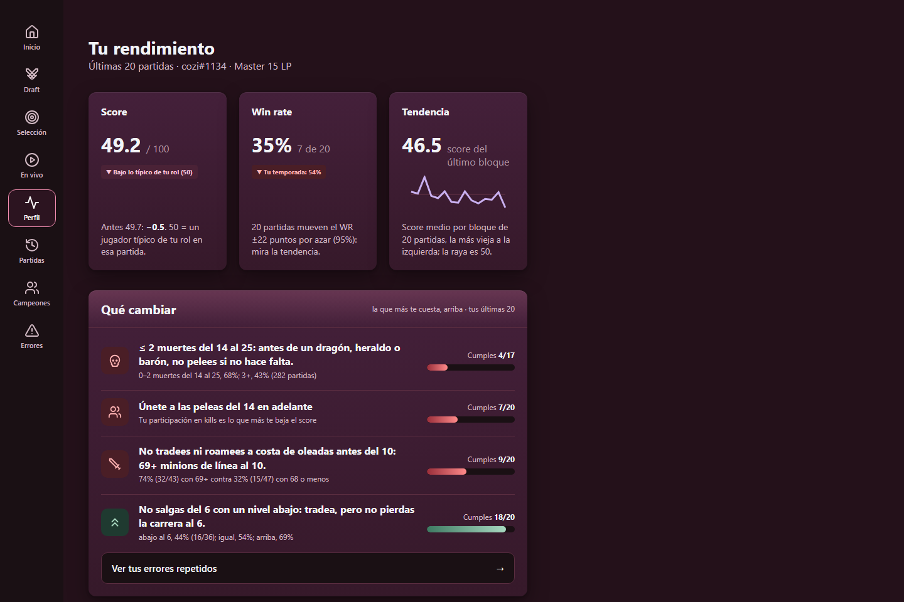
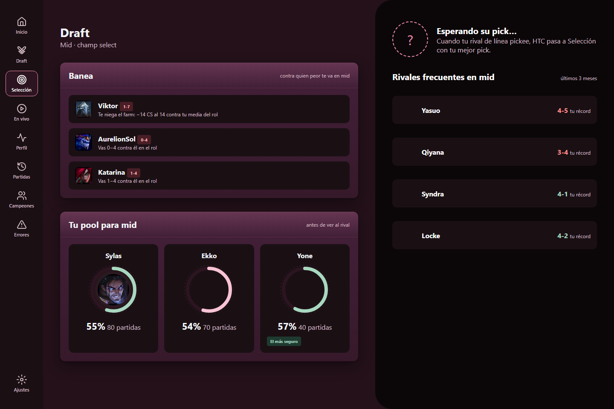
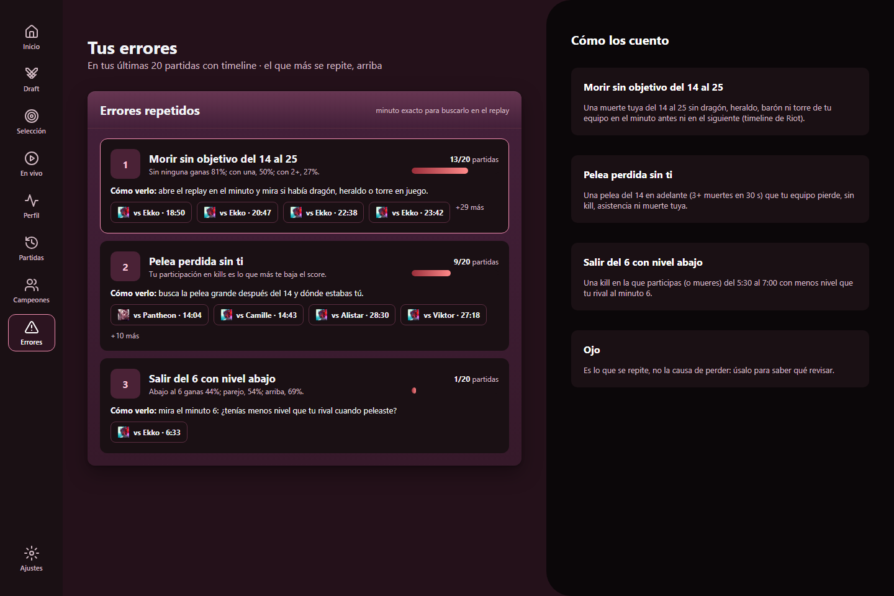
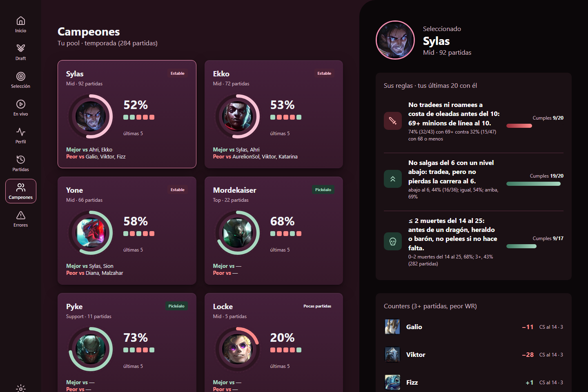
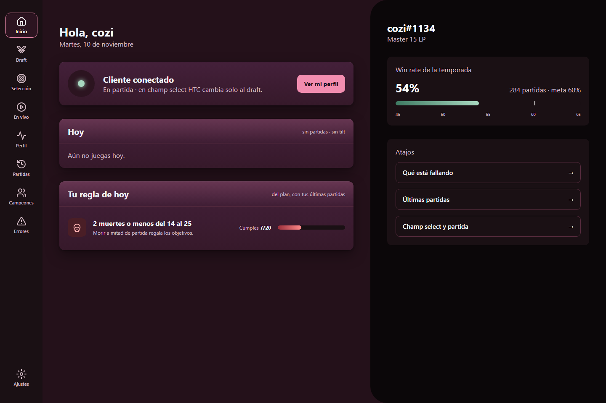

<p align="center">
  
</p>

<h1 align="center">HTC · How to Climb</h1>

<p align="center">
  <b>Deja de adivinar por qué pierdes.</b><br>
  Tu coach de League of Legends, hecho con <i>tus</i> partidas.
</p>

<p align="center">
  <a href="https://github.com/C0z1/plan-de-accion-challenger/releases/latest"></a>
</p>

<p align="center">
  
</p>

---

## Por qué HTC

Las guías te dicen cómo juega un Challenger. HTC te dice **qué te hace perder a ti**.

- 🎯 **Consejos que salen de tus partidas.** Nada de «farmea más». HTC encuentra, por ejemplo, que *con 2 muertes o menos del minuto 14 al 25 ganas el 68%, y con 3 o más, el 43%*, y te lo recuerda cuando importa.
- ⚡ **Aparece sola cuando abres LoL.** En el champ select te dice qué pickear y en partida te muestra a tu rival y los objetivos. No hay que configurar nada ni hacer clics.
- 🛡️ **Juego limpio.** HTC solo lee. No juega por ti, no toca el cliente y no te da ventajas que tu rival no tenga.

## Te acompaña en cada momento

### Champ select: qué banear y qué pickear
Contra quién peor te va, tu récord contra cada rival y cuál de tus campeones es la apuesta más segura. Cuando tu rival de línea pickea, HTC te da tu plan para esa partida.

<p align="center"></p>

### En partida: tu rival y los objetivos, de un vistazo
Tu nivel y tus minions contra los de tu rival, sus ítems, quién va ganando en dragones, torres y barón, y cuánto falta para el próximo objetivo.

### Después: tus errores, con el minuto exacto
HTC encuentra los errores que repites y te da el minuto para buscarlos en el replay. Sabes qué revisar sin ver la partida entera.

<p align="center"></p>

### Tus campeones, sin engañarte
Con quién ganas de verdad, contra quién sufres y las reglas que más te cuestan con cada campeón.

<p align="center"></p>

### Tu día, al abrir el juego
Un saludo, tu win rate contra tu meta y la regla que más te conviene cuidar hoy.

<p align="center"></p>

## Empieza en un minuto

1. **[Descarga el instalador](https://github.com/C0z1/plan-de-accion-challenger/releases/latest)** y ábrelo. No pide permisos de administrador.
2. **Abre LoL.** HTC aparece sola.
3. **Juega.** En el champ select y en partida, HTC hace el resto.

> **¿Windows dice «Windows protegió su PC»?** Pasa con las apps nuevas que todavía no tienen firma digital. Dale a **Más información → Ejecutar de todas formas**.

## Preguntas frecuentes

**¿Me pueden banear por usarla?**
HTC solo **lee** la información que el propio cliente de LoL ofrece a las apps: la misma que ya ves en tu pantalla. No pickea, no banea, no acepta partidas y no modifica el juego.

**¿Mis datos se van a algún lado?**
No. Todo se queda en tu computadora.

**¿Cuánto cuesta?**
Es gratis y de código abierto.

**¿Funciona en mi servidor?**
Sí: LAN, LAS, NA, EUW, KR y el resto de servidores de Riot.

**Está en beta: ¿qué falta?**
Tu historial completo (Perfil, Errores, Campeones) llega en la próxima versión. El champ select y la partida en vivo ya funcionan. ¿Encontraste algo raro? [Cuéntanos](https://github.com/C0z1/plan-de-accion-challenger/issues).

---

<details>
<summary><b>Para desarrolladores</b></summary>

HTC está hecha en Python sin dependencias. Corre un servidor local y muestra la ventana con Edge en modo app. Solo lee de tres fuentes: la Riot API (con tu key), la API local del cliente (LCU) y la Live Client Data API.

```bash
python scripts/companion_web.py --demo      # la app con datos de ejemplo, sin cliente
python -m unittest discover scripts         # pruebas: sin red, sin key, sin partidas
```

La guía completa, las variables (`RIOT_KEY`, `RIOT_ID`, `RIOT_REGION`) y los scripts están en [`docs/USO.md`](docs/USO.md). Los PRs son bienvenidos.

</details>

<p align="center"><sub>Licencia <a href="LICENSE">MIT</a></sub></p>

<sub>HTC isn't endorsed by Riot Games and doesn't reflect the views or opinions of Riot Games or anyone officially involved in producing or managing Riot Games properties. Riot Games, and all associated properties are trademarks or registered trademarks of Riot Games, Inc.</sub>
