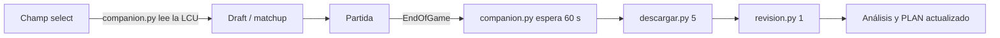

# 🎯 Plan Challenger

<div align="center">


</div>

Herramienta local de código abierto que descarga tus partidas de Solo/Duo, ejecuta análisis sobre tus propios datos y convierte hallazgos en reglas accionables. Todo en Python estándar, sin dependencias.

## 🚀 Inicio rápido

```bash
# 1) Clona el repositorio
git clone https://github.com/C0z1/plan-de-accion-challenger.git
cd plan-de-accion-challenger

# 2) Configura tus variables de entorno
# Windows (persistente; reabre la terminal después de setx)
setx RIOT_KEY "tu_riot_api_key"
setx RIOT_ID "tu_riot_id#tag"       # ejemplo: cozi#1134
setx RIOT_REGION "la1"              # plataforma: la1, na1, euw1, kr, br1, jp1, etc.

# macOS / Linux
export RIOT_KEY="tu_riot_api_key"
export RIOT_ID="tu_riot_id#tag"
export RIOT_REGION="la1"

# 3) Descarga tus últimas partidas
python scripts/descargar.py 300

# 4) Genera estadísticas agregadas
python scripts/analizar.py

# 5) Deja correr al companion mientras juegas
python scripts/companion.py
```

> Si no defines `RIOT_ID` ni `RIOT_REGION`, usa `cozi#1134` en `la1` (el caso de estudio).

Opcional:
- **Tu pool y tus metas:** copia `config.ejemplo.json` a `config.json` (no se sube a git) y pon tus campeones. Sin `config.json`, `revision.py` toma como pool tus 3 campeones más jugados; la meta de minions al 10 (`minions10`) solo aparece si la defines.
- **Otra carpeta de datos:** `DATOS_DIR=<carpeta>` hace que todos los scripts lean y escriban ahí en vez de `datos/raw` (útil para analizar otra cuenta sin mezclar).

### 🎮 Companion

`companion.py` lee el cliente de League of Legends en modo **solo lectura** (nunca elige, banea ni acepta por ti):

| Momento | Qué hace |
|---|---|
| Champ select | Cuando tu rival de línea elige, corre `draft.py <rival> <tu rol>` y te muestra qué pickear. Sin roles asignados (normales), lo corre contra cada rival ya elegido. |
| En partida | Cada 30 s guarda una foto de la Live Client Data API (oro, nivel, ítems, eventos) en `datos/vivo/<inicio>.jsonl` (no se sube a git). Del minuto 5 al 7, si vas abajo de nivel contra tu rival de línea, lo avisa una vez (en la ventana, como banner): «no tradees hasta igualar». |
| Fin de partida | Espera 60 s, baja tus 5 últimas (`descargar.py 5`) y revisa la nueva (`revision.py 1`). |
| Key caducada o partida sin publicar | Te dice qué correr a mano después. |

```bash
python scripts/companion.py --help                              # uso
python scripts/companion.py                                     # déjalo abierto mientras juegas (Ctrl+C para salir)
python scripts/companion.py --fixture scripts/fixtures/champselect   # prueba sin cliente, con JSON de ejemplo
```

Busca el cliente en `C:\Riot Games\League of Legends\lockfile`; si lo instalaste en otro lado, pon la ruta en `LOL_LOCKFILE`.

---

## 🖥️ Companion con ventana

`scripts/companion_gui.py` es el companion con interfaz: una ventana lateral oscura que en champ select muestra a tu rival de línea, tu récord contra él y el pick recomendado (con barras por campeón), y al terminar la partida descarga y marca las metas del plan (oro y CS al 14, muertes del 14 al 25, pool). Igual que el companion de consola: **solo lectura**.

```bash
python scripts/companion_gui.py           # con el cliente abierto
python scripts/companion_gui.py --demo    # vista de ejemplo, sin cliente
```

**App web (v0.1.4):** `scripts/companion_web.py` es el companion con el diseño nuevo (champ select, franja en partida, línea al terminar y «Tu rendimiento»), servido en 127.0.0.1 y abierto como ventana de Edge. `--demo` recorre las tres fases sin cliente. `companion_gui.py` (tkinter) queda de respaldo.

**HTC (How to Climb) v0.2.0 para Windows** (no lo sube git; se compila en un paso):

```powershell
pip install pyinstaller; winget install JRSoftware.InnoSetup
powershell -File instalador/build.ps1
```

Deja `dist/HTC/HTC.exe` (corre sin instalar y usa los datos de este repo) y `dist/HTC-Setup-0.2.0.exe`, un instalador por usuario (sin admin) que lo pone en `%LOCALAPPDATA%\Programs\HTC` con sus propios `datos/`. Es `--onedir`: no se desempaca en cada arranque (responde en ~0.5 s; antes, en 1.1–1.4 s). «Tu rendimiento» sale de la caché `datos/cache/rendimiento.json` mientras no cambien tus partidas (27 ms; antes, 1 s). La key se lee de `RIOT_KEY` (`setx RIOT_KEY <key>`).

---

## 🔄 Flujo de trabajo



---

## 📦 Scripts

| Grupo | Script | Qué hace |
|---|---|---|
| Recolección | `descargar.py` | Descarga partidas de Solo/Duo desde la Riot API a `datos/raw/`. |
| Recolección | `companion_gui.py` | El companion con ventana (y `Companion.exe`). |
| Recolección | `companion.py` | Acompañante local del cliente: champ select sin POST/PATCH y descarga/revisión post-partida. |
| Recolección | `analizar.py` | Resume `datos/raw/*.json` en estadísticas agregadas. |
| Antes de la partida | `draft.py` | Matchups y draft con tus datos. |
| Después de la partida | `revision.py` | Revisa tus últimas N partidas contra las metas del PLAN. |
| Después de la partida | `score.py` | Score por partida contra tu equipo y la partida (50 = típico de tu rol), tendencia, V/D y qué componente te baja. |
| Después de la partida | `partida.py` | Replay en datos minuto a minuto; usa `--early` para narrar 0–12. |
| Análisis profundo | `early.py` | ¿Qué separa victorias de derrotas en el early por campeón? |
| Análisis profundo | `timeline.py` | Diferencias a 10/14/20, muertes por fase y objetivos. |
| Análisis profundo | `midgame.py` | Por qué pierdes partidas tras llegar al 14 con ventaja de oro. |
| Análisis profundo | `linea.py` | Cómo pierdes la línea y cuál línea perdida se remonta. |
| Análisis profundo | `convertir.py` | Por qué no conviertes una línea ganada. |
| Análisis profundo | `xp.py` | De dónde sale la XP perdida contra tu rival de línea. |
| Análisis profundo | `nivel6.py` | Nivel contra tu rival antes del 14 y desenlace. |
| Análisis profundo | `muertes6.py` | Muertes antes del minuto 6 por tipo y campeón. |
| Análisis profundo | `wards.py` | Control wards y win rate. |
| Análisis profundo | `objetivos.py` | Objetivos, ganks y late. |
| Análisis profundo | `placas.py` | Placas reales del timeline contra win rate. |
| Análisis profundo | `castigo.py` | Cómo castigas una línea perdida. |
| Análisis profundo | `rol.py` | Compara mid vs top como rol principal. |

---

## 🧭 Tu plan personal

- `PLAN.md`: el plan con las reglas que salen de los datos. `TARJETA.md`: esas reglas en una página para tener a mano mientras juegas. `BITACORA.md`: el seguimiento.
- Con [Claude Code](https://claude.com/claude-code), el agente `.claude/agents/coach-challenger.md` hace el diagnóstico y el plan: *"Usa el agente coach-challenger para hacer el diagnóstico inicial."*
- Tu pool y la meta de minions van en `config.json`; las demás metas de `revision.py` y estos documentos son los del caso de estudio: ajústalos a tu cuenta.

---

## 📈 Caso de estudio: cozi#1134 (LAN, Master → Challenger)

Punto de partida público:

| Dato | Valor |
|---|---|
| Rango actual | Master 15 LP |
| Pico | Master 346 LP |
| Temporada S2026 | 185W 156L (341 partidas, 54% WR) |
| Últimas 20 partidas | 40% WR |
| Ladder | #8,907 (top 1.12%) |
| Temporada anterior | Gold 3 (S2025) |
| Clases | Mago 60%, Tirador 24%, Luchador 11% |
| Campeones principales | Ekko, Sylas, Yasuo, Yone |
| KDA / KP promedio | 2.35 / 46% |

Actualmente hay **284 partidas analizadas**.

Hallazgos reales obtenidos de los datos:

- **Oro al 14:** pasar de −1 000 a +1 000 de ventaja contra el rival de línea sube el win rate de **41% a 72%**.
- **Detrás en línea:** a igualdad de oro, la XP pesa más que el CS: **65% vs 27%** de win rate.
- **Sylas:** más de **68 minions al 10** → **74% WR**; 68 o menos → **32% WR**.
- **Mid game:** **0–2 muertes** del minuto 14 al 25 → **74% WR**; **3+ muertes** → ~50%.
- **Top/bot con ventaja de nivel:** cruzar el río sin ver al jungla multiplica por **1.89** las muertes.
- **Morir antes del minuto 6** no afecta el WR por sí solo (**59% vs 50%**); ir por debajo de nivel al 6 apunta a **44% WR**.
- **Control wards antes del 14:** no redujeron ganks ni subieron el win rate en una muestra de **1,431 jugadores de línea**.
- **Pool resultante:** mid **Yone** (principal) y **Ekko**; top **Mordekaiser**; Sylas solo con matchup claro.

---

## 🔒 Privacidad y uso de la API

- Cada persona usa **su propia** `RIOT_KEY` de desarrollador o personal.
- El cliente local se consulta **solo en lectura** vía LCU: `companion.py` nunca ejecuta POST/PATCH ni automatiza acciones.
- No se almacenan datos de otros jugadores fuera de tu máquina.
- `datos/raw/` está en `.gitignore`: las partidas crudas no se comparten al hacer push.
- Pensado para cumplir las políticas de Riot para desarrolladores: uso personal y de bajo volumen.

---

## ✅ Pruebas

```bash
python -m unittest discover scripts
```

Las pruebas no requieren red, `RIOT_KEY` ni partidas descargadas (sin `datos/raw` usan `scripts/fixtures/datos`). GitHub Actions las corre en Ubuntu y Windows en cada push (`.github/workflows/pruebas.yml`).

---

## ⚖️ Aviso legal

> Plan Challenger isn't endorsed by Riot Games and doesn't reflect the views or opinions of Riot Games or anyone officially involved in producing or managing Riot Games properties. Riot Games, and all associated properties are trademarks or registered trademarks of Riot Games, Inc.
