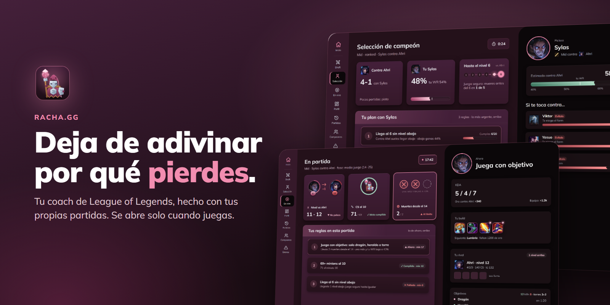
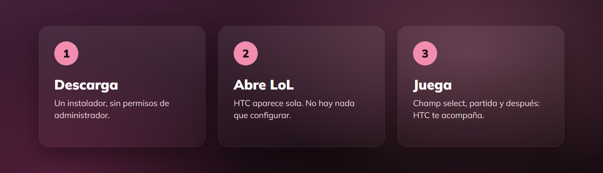
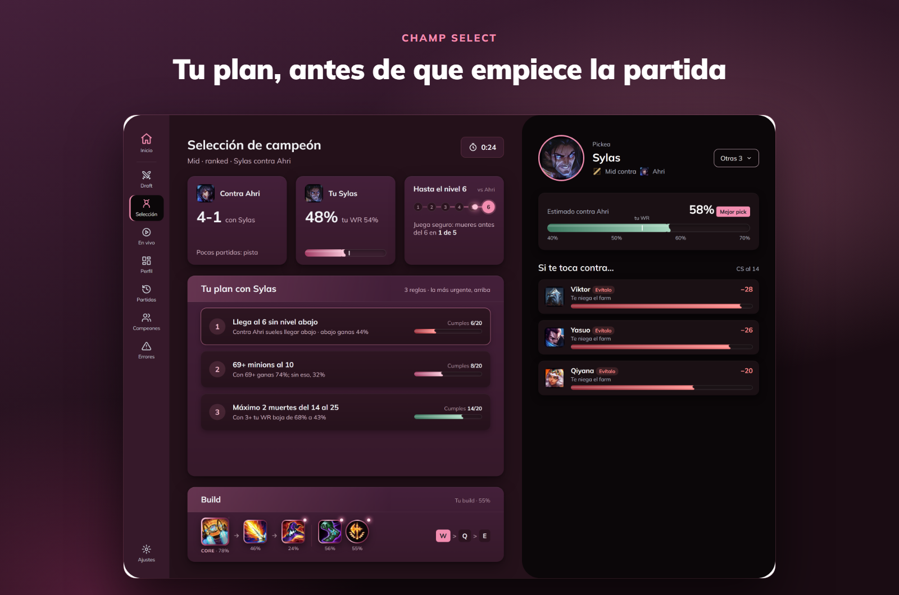
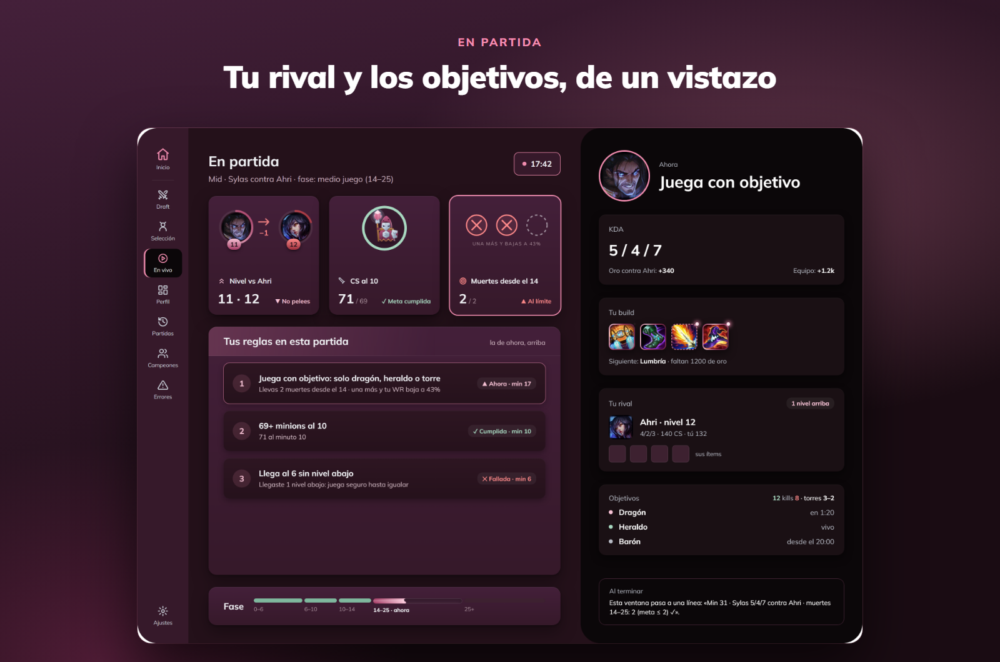
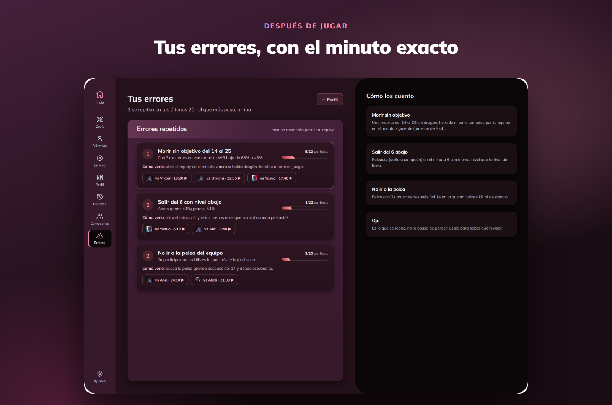
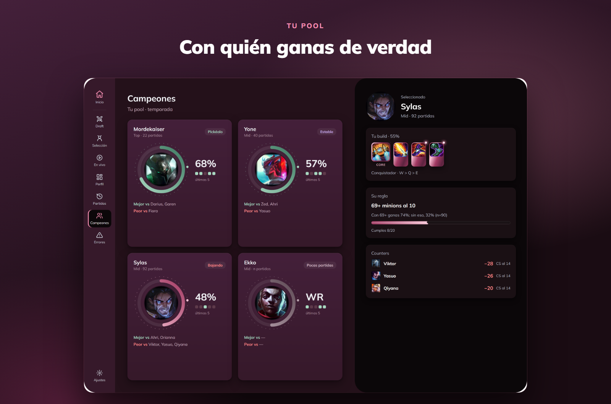
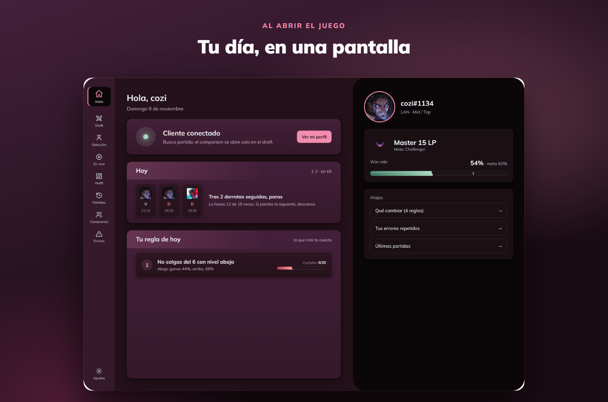

<p align="center">
  
</p>

<p align="center">
  <a href="https://github.com/C0z1/racha.gg/releases/latest"></a>
</p>

<p align="center">
  Las guías te dicen cómo juega un Challenger.<br>
  <b>Racha te dice qué te hace perder <i>a ti</i></b>, y te lo recuerda justo cuando importa.
</p>

<p align="center">
  
</p>

<br>

<p align="center">
  
</p>
<p align="center">Tu récord contra ese rival, tu mejor pick y <b>3 reglas para esa partida</b>, antes de que cargue la pantalla.</p>

<br>

<p align="center">
  
</p>
<p align="center">Tu nivel y tus minions contra los de tu rival, sus ítems y <b>cuánto falta para dragón y barón</b>, sin salir del juego.</p>

<br>

<p align="center">
  
</p>
<p align="center">Los errores que repites, <b>con el minuto exacto</b> para buscarlos en el replay. Nada de ver la partida entera.</p>

<br>

<p align="center">
  
</p>
<p align="center">Con quién ganas de verdad, contra quién sufres y <b>qué cuidar con cada campeón</b>.</p>

<br>

<p align="center">
  
</p>
<p align="center">Al abrir LoL: tu racha del día, <b>la regla que más te conviene cuidar hoy</b> y tu win rate contra tu meta.</p>

<br>

##  Por qué Racha

|  |  |
|---|---|
|  **Hecho con tus partidas** | Nada de «farmea más». Racha descubre, por ejemplo, que *con 2 muertes o menos del minuto 14 al 25 ganas el 68%, y con 3 o más, el 43%*. |
|  **Aparece sola** | Se abre cuando abres LoL y cambia de pantalla según la fase: champ select, partida y final. Cero clics. |
|  **Juego limpio** | Solo lee lo que el cliente ofrece a las apps. No juega por ti, no toca el juego y no da ventajas injustas. |
|  **Tus datos son tuyos** | Todo se queda en tu computadora. |

##  Preguntas frecuentes

<details>
<summary><b>¿Me pueden banear por usarla?</b></summary>
<br>
Racha solo <b>lee</b> la información que el propio cliente de LoL ofrece a las apps, la misma que ya ves en tu pantalla. No pickea, no banea, no acepta partidas y no modifica el juego.
</details>

<details>
<summary><b>¿Cuánto cuesta?</b></summary>
<br>
Es gratis y de código abierto.
</details>

<details>
<summary><b>¿Funciona en mi servidor?</b></summary>
<br>
Sí: LAN, LAS, NA, EUW, KR y el resto de servidores de Riot.
</details>

<details>
<summary><b>Windows dice «Windows protegió su PC». ¿Es seguro?</b></summary>
<br>
Pasa con las apps nuevas que todavía no tienen firma digital. Dale a <b>Más información → Ejecutar de todas formas</b>. El código está aquí mismo, a la vista de todos.
</details>

<details>
<summary><b>Está en beta: ¿qué falta?</b></summary>
<br>
El champ select y la partida en vivo ya funcionan. Tu historial completo (Perfil, Errores, Campeones) llega en la próxima versión. Las imágenes muestran el diseño con datos de ejemplo. ¿Encontraste algo raro? <a href="https://github.com/C0z1/racha.gg/issues">Cuéntanos</a>.
</details>

<br>

<p align="center">
  <a href="https://github.com/C0z1/racha.gg/releases/latest"></a>
</p>

---

<details>
<summary>Para desarrolladores</summary>
<br>

Racha está hecha en Python sin dependencias. Corre un servidor local y muestra la ventana con Edge en modo app. Solo lee de tres fuentes: la Riot API (con tu key), la API local del cliente (LCU) y la Live Client Data API.

```bash
python scripts/companion_web.py --demo      # la app con datos de ejemplo, sin cliente
python -m unittest discover scripts         # pruebas: sin red, sin key, sin partidas
```

Guía completa, variables (`RIOT_KEY`, `RIOT_ID`, `RIOT_REGION`) y scripts: [`docs/USO.md`](docs/USO.md). Los PRs son bienvenidos. Licencia [MIT](LICENSE).

</details>

<sub>Racha isn't endorsed by Riot Games and doesn't reflect the views or opinions of Riot Games or anyone officially involved in producing or managing Riot Games properties. Riot Games, and all associated properties are trademarks or registered trademarks of Riot Games, Inc.</sub>
